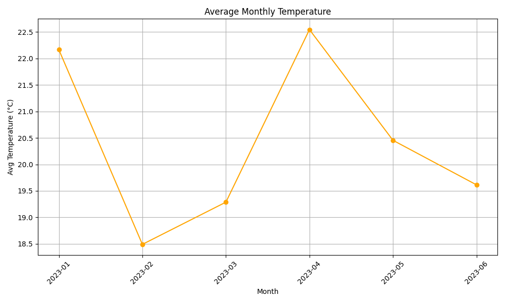
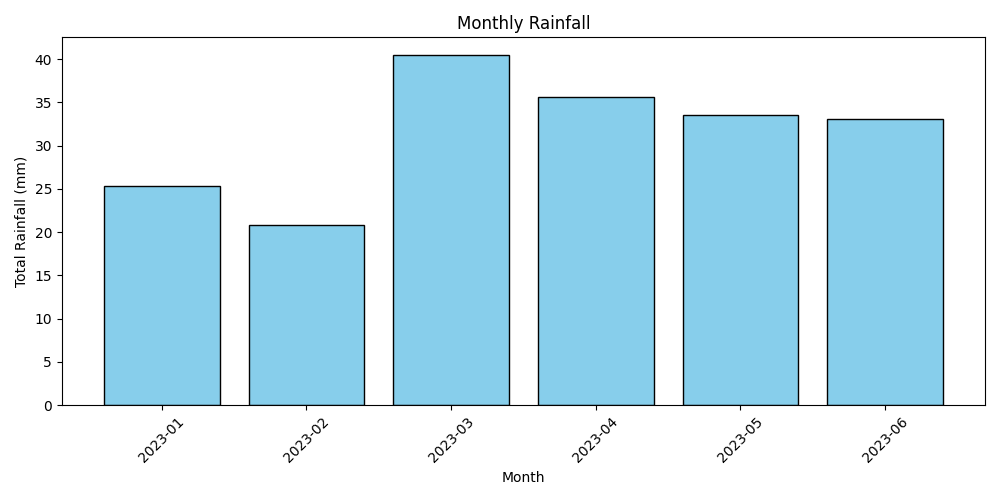
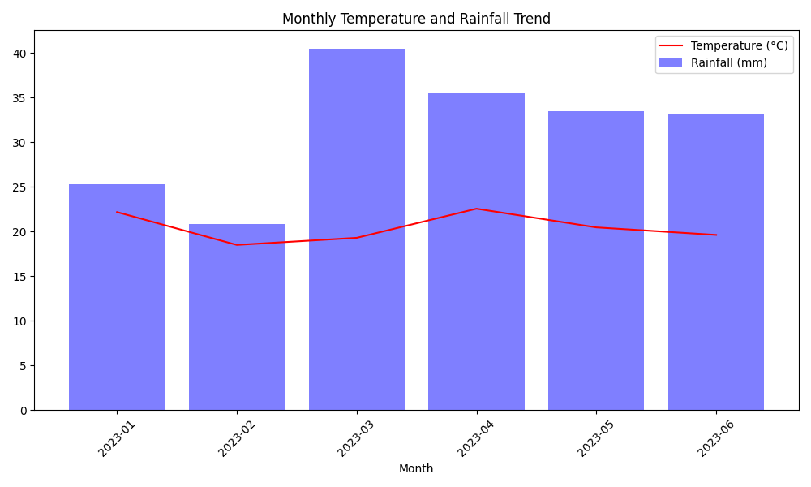

# Weather Data Project

A Python program that loads daily weather data, analyses it and draws charts. Built as first-year Python coursework at Liverpool Hope University.

## Features

- Loads and cleans weather data from a CSV file
- Calculates monthly statistics for temperature, rainfall and humidity
- Sort, search by date or month, and filter by a range through a text menu
- Plots charts with matplotlib (examples below)
- Saves the data to a SQLite database and exports results to CSV

## Files

- `generate_weather_data.py` creates the sample data file `weather_data.csv`
- `weather_processor.py` is the main program

## How to run

```
pip install pandas matplotlib numpy
python generate_weather_data.py
python weather_processor.py
```

## Example charts




